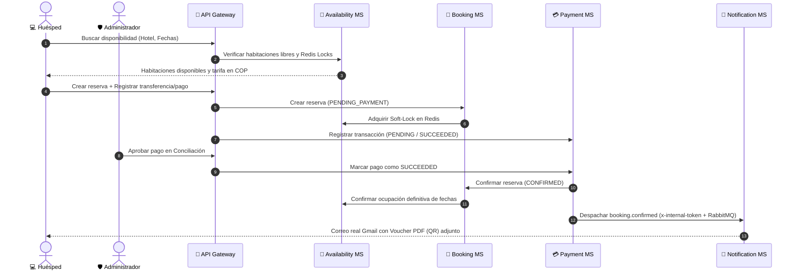
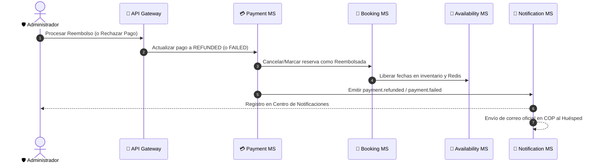

# 🏨 Travel & Resorts — Plataforma Cloud-Native de Microservicios para Gestión y Reservas Hoteleras

> **Documento Oficial de Arquitectura del Sistema, Especificación de Microservicios, Seguridad RBAC y Guía de Despliegue (Docker Local & Cloud en Render + Vercel).**

---

## 📑 Tabla de Contenidos

1. [Visión General del Sistema](#-visión-general-del-sistema)
2. [Arquitectura Global de la Solución](#-arquitectura-global-de-la-solución)
   - [Diagrama de Arquitectura de Alto Nivel](#diagrama-de-arquitectura-de-alto-nivel)
   - [Principios de Diseño y Patrones Arquitectónicos](#principios-de-diseño-y-patrones-arquitectónicos)
3. [Catálogo de Microservicios Implementados](#-catálogo-de-microservicios-implementados)
   - [1. API Gateway Unificado](#1-api-gateway-unificado)
   - [2. Auth Service (Usuarios y Autenticación)](#2-auth-service-usuarios-y-autenticación)
   - [3. Hotels Service (Catálogo de Sedes)](#3-hotels-service-catálogo-de-sedes)
   - [4. Rooms Service (Inventario de Habitaciones)](#4-rooms-service-inventario-de-habitaciones)
   - [5. Availability Service (Disponibilidad & Redis Locks)](#5-availability-service-disponibilidad--redis-locks)
   - [6. Booking Service (Orquestador de Reservas)](#6-booking-service-orquestador-de-reservas)
   - [7. Payment Service (Pagos, Conciliación y Reembolsos)](#7-payment-service-pagos-conciliación-y-reembolsos)
   - [8. Notification Service (Correos Reales SMTP & Vouchers PDF con QR)](#8-notification-service-correos-reales-smtp--vouchers-pdf-con-qr)
4. [Flujos de Negocio y Patrón Saga](#-flujos-de-negocio-y-patrón-saga)
   - [Flujo de Reserva y Aprobación Exitoso](#flujo-de-reserva-y-aprobación-exitoso)
   - [Flujo de Rechazo y Reembolso Sincronizado](#flujo-de-rechazo-y-reembolso-sincronizado)
5. [Roles, Permisos (RBAC) y Seguridad Zero-Trust](#-roles-permisos-rbac-y-seguridad-zero-trust)
6. [Estrategia Técnica Anti-Overbooking](#-estrategia-técnica-anti-overbooking)
7. [Estructura del Proyecto (Monorepo)](#-estructura-del-proyecto-monorepo)
8. [Matriz de Puertos y Variables de Entorno](#-matriz-de-puertos-y-variables-de-entorno)
9. [Guía de Ejecución Local (Docker Compose)](#-guía-de-ejecución-local-docker-compose)
10. [Despliegue en la Nube (Render + Vercel — 100% Gratis)](#-despliegue-en-la-nube-render--vercel--100-gratis)
11. [Estado del Proyecto](#-estado-del-proyecto)

---

## 📌 Visión General del Sistema

**Travel & Resorts — Luxury Collection** es una plataforma distribuida de reservas hoteleras orientada a eventos (*Event-Driven Architecture*), diseñada con **8 servicios NestJS**, **1 Frontend SPA editorial**, **6 bases de datos PostgreSQL**, **Redis** y **RabbitMQ** (18 contenedores en total en Docker Compose).

### Capacidades Clave Implementadas
- **Búsqueda de disponibilidad en tiempo real** y cotización dinámica en **Pesos Colombianos (`COP`)**.
- **Prevención estricta de sobreventa (Anti-Overbooking)** mediante bloqueos atómicos en Redis (*Soft-Locks / Holds* con scripts Lua) y verificación de rangos de fechas en PostgreSQL.
- **Orquestación de reservas, pagos y reembolsos (Patrón Saga)** con sincronización bidireccional (HTTP interno + RabbitMQ) para aprobaciones, rechazos y reembolsos.
- **Notificaciones transaccionales reales por Gmail SMTP** (bienvenida, confirmación con **Voucher PDF oficial y código QR**, pago rechazado, recordatorio de check-in y comprobante de reembolso) con deduplicación concurrente.
- **Seguridad Zero-Trust y RBAC** en el API Gateway: bloqueo de endpoints internos (`/internal/*`, `/confirm-hold`), limpieza anti-spoofing de cabeceras `x-user-*`, autenticación JWT con BCrypt y cero contraseñas quemadas en el repositorio.
- **Interfaz Editorial SPA Moderna** con diálogos modales personalizados, toasts de retroalimentación, panel de métricas ejecutivas, gestión de cuentas, conciliación de pagos/reembolsos y descarga de Vouchers PDF.
- **Listo para la Nube (Cloud-Ready):** soporte nativo para `DATABASE_URL` con SSL (Neon.tech / Supabase), `REDIS_URL` con TLS (Upstash), `RABBITMQ_URL` con AMQPS (CloudAMQP), Blueprint de **Render** (`render.yaml`) y rewrites de **Vercel** (`frontend/vercel.json`).

---

## 🏛 Arquitectura Global de la Solución

### Diagrama de Arquitectura de Alto Nivel

```mermaid
graph TB
    subgraph "Capa de Presentación"
        ClientWeb["💻 Frontend SPA (HTML5 / CSS Editorial / Vanilla JS)\nNginx Local (:5173) o Vercel (HTTPS)"]
    end

    subgraph "Capa Perimetral & Seguridad"
        Gateway["🚪 API Gateway (NestJS - :3000)\n- Reverse Proxy Dinámico\n- Rate Limiting (Throttler)\n- Validación JWT + Anti-Spoofing\n- Bloqueo de rutas /internal/*"]
    end

    subgraph "Microservicios Core (NestJS)"
        AuthMS["🔐 Auth Service (:3001)\nPostgreSQL (hotel_auth_db)"]
        HotelMS["🏨 Hotels Service (:3002)\nPostgreSQL (hotel_hotels_db)"]
        RoomMS["🛏️ Rooms Service (:3003)\nPostgreSQL (hotel_rooms_db)"]
        AvailMS["📅 Availability Service (:3004)\nPostgreSQL + Redis (Locks)"]
        BookingMS["📝 Booking Service (:3005)\nPostgreSQL (hotel_booking_db)"]
        PaymentMS["💳 Payment Service (:3006)\nPostgreSQL (hotel_payment_db)"]
        NotifMS["🔔 Notification Service (:3008)\nNodemailer (Gmail SMTP) + PDFKit + QR"]
    end

    subgraph "Mensajería Asíncrona"
        RabbitMQ["📨 RabbitMQ (:5672 / :15672 UI)\nCola: hotel_notifications_queue"]
    end

    ClientWeb -->|HTTPS / REST /api/*| Gateway

    Gateway -->|/api/auth/*| AuthMS
    Gateway -->|/api/hotels/*| HotelMS
    Gateway -->|/api/rooms/*| RoomMS
    Gateway -->|/api/availability/*| AvailMS
    Gateway -->|/api/bookings/*| BookingMS
    Gateway -->|/api/payments/*| PaymentMS
    Gateway -->|/api/notifications/*| NotifMS

    AuthMS -.->|user.registered| RabbitMQ
    BookingMS -.->|booking.confirmed / cancelled| RabbitMQ
    PaymentMS -.->|payment.succeeded / failed / refunded| RabbitMQ
    RabbitMQ -.->|Consume eventos| BookingMS
    RabbitMQ -.->|Consume eventos| AvailMS
    RabbitMQ -.->|Consume eventos| NotifMS
```



### Principios de Diseño y Patrones Arquitectónicos

1. **Database per Service:** Cada microservicio administra sus propias tablas (`users`, `hotels`, `rooms`, `room_reservations`, `bookings`, `payments`). En local corre en 6 contenedores PostgreSQL independientes; en despliegues gratuitos cloud puede compartir una única instancia PostgreSQL (Neon.tech) sin colisiones de esquema.
2. **API Gateway Pattern (Zero-Trust):** Único punto de entrada que aplica *rate limiting*, verifica JWT, elimina cabeceras inyectadas maliciosamente y bloquea rutas internas.
3. **Event-Driven Architecture (EDA) + Respaldo Síncrono:** Eventos publicados en RabbitMQ complementados con llamadas internas protegidas por `x-internal-token` y deduplicación en vuelo (`inFlightKeys`) para garantizar entrega sin duplicados.
4. **Patrón Saga con Compensación y Reconciliación:** Si un pago falla, es rechazado o es reembolsado, el estado de la reserva se actualiza automáticamente y las fechas se liberan en `availability-service`.

---

## 🧩 Catálogo de Microservicios Implementados

### 1. API Gateway Unificado
- **Directorio:** `gateway/` · **Puerto:** `3000`
- **Tecnología:** NestJS, `@nestjs/jwt`, `@nestjs/throttler`, `http-proxy-middleware`.
- **Responsabilidades:**
  - Enrutamiento dinámico hacia los 7 microservicios downstream (soporta URLs locales Docker y hostnames HTTPS de Render).
  - Validación JWT y propagación segura de `x-user-id`, `x-user-email` y `x-user-role`.
  - Protección perimetral: bloquea con `403 Forbidden` cualquier petición externa a `/internal/*` o `/confirm-hold`.
  - Monitoreo centralizado en `/health` y `/health/services`.

| Ruta Solicitada | Servicio Destino | Propósito |
|---|---|---|
| `/api/auth/*` | `auth-service:3001` | Registro, login, perfiles y gestión de usuarios |
| `/api/hotels/*` | `hotels-service:3002` | Catálogo de 6 hoteles colombianos y sedes |
| `/api/rooms/*` | `rooms-service:3003` | Inventario de habitaciones, tarifas en COP y estados |
| `/api/availability/*` | `availability-service:3004` | Búsqueda de disponibilidad, bloqueos Redis y calendario |
| `/api/bookings/*` | `booking-service:3005` | Ciclo de vida de reservas, Check-In y Check-Out |
| `/api/payments/*` | `payment-service:3006` | Pagos, aprobación/rechazo de transferencias y reembolsos |
| `/api/notifications/*` | `notification-service:3008` | Bandeja personal/global de notificaciones y descarga de Vouchers PDF |
| `/health`, `/health/services` | Interno (Gateway) | Salud del Gateway y conectividad de microservicios |

---

### 2. Auth Service (Usuarios y Autenticación)
- **Directorio:** `services/auth-service/` · **Puerto:** `3001` · **BD:** `hotel_auth_db` (`users`)
- **Características:**
  - Hashing seguro con **BCrypt** y emisión de tokens **JWT**.
  - Registro público restringido estrictamente al rol `GUEST` (emite correo de bienvenida automático).
  - Siembra segura del Administrador mediante variables de entorno (`ADMIN_SEED_EMAIL`, `ADMIN_SEED_PASSWORD`).
  - Migración automática al arranque (`pre-boot.migration.ts`) compatible con PostgreSQL local y `DATABASE_URL` SSL.

---

### 3. Hotels Service (Catálogo de Sedes)
- **Directorio:** `services/hotels-service/` · **Puerto:** `3002` · **BD:** `hotel_hotels_db` (`hotels`)
- **Características:**
  - Catálogo pre-sembrado de 6 sedes de lujo en Colombia (Cartagena, Medellín, San Andrés, Bogotá, Santa Marta y Eje Cafetero).
  - Filtros por ciudad, estrellas y búsqueda de texto, más CRUD completo para `HOTEL_ADMIN`.

---

### 4. Rooms Service (Inventario de Habitaciones)
- **Directorio:** `services/rooms-service/` · **Puerto:** `3003` · **BD:** `hotel_rooms_db` (`rooms`)
- **Características:**
  - Categorías de habitaciones (*Standard*, *Deluxe*, *Junior Suite*, *Presidential Suite*, *Penthouse*), capacidades, amenidades y tarifas base en **COP**.
  - Sincronización automática de UUIDs de hoteles desde `hotels-service` y control de estado operativo (`AVAILABLE`, `MAINTENANCE`, `INACTIVE`).

---

### 5. Availability Service (Disponibilidad & Redis Locks)
- **Directorio:** `services/availability-service/` · **Puerto:** `3004` · **BD:** `hotel_availability_db` (`room_reservations`) + **Redis**
- **Características:**
  - Consulta en tiempo real cruzando habitaciones, reservas confirmadas y bloqueos temporales.
  - **Soft-Locks atómicos en Redis** mediante script Lua (soporta Redis local y `REDIS_URL` con TLS de Upstash).
  - Calendario mensual por habitación y bloqueo/desbloqueo manual de fechas por el Administrador.

---

### 6. Booking Service (Orquestador de Reservas)
- **Directorio:** `services/booking-service/` · **Puerto:** `3005` · **BD:** `hotel_booking_db` (`bookings`)
- **Características:**
  - Estados: `PENDING_PAYMENT`, `CONFIRMED`, `CHECKED_IN`, `COMPLETED` y `CANCELLED` (incluyendo distinción visual de **`Reembolsada`** cuando proviene de reversión financiera).
  - Genera códigos únicos (`TR-2026-XXXXX`), calcula noches (`nightsCount`) y valor total en COP.
  - Escucha eventos RabbitMQ (`payment.succeeded`, `payment.failed`, `payment.refunded`) con arranque tolerante a fallos.

---

### 7. Payment Service (Pagos, Conciliación y Reembolsos)
- **Directorio:** `services/payment-service/` · **Puerto:** `3006` · **BD:** `hotel_payment_db` (`payments`)
- **Características:**
  - Soporta pagos con tarjeta (Sandbox) y pagos por **Transferencia Bancaria / WhatsApp Directo** con conciliación administrativa.
  - **Llaves de idempotencia** para evitar cobros duplicados.
  - **Flujo completo de Reembolso (`POST /api/payments/:id/refund`):** cambia el pago a `REFUNDED`, cancela/marca como reembolsada la reserva en `booking-service`, libera las fechas en `availability-service` y despacha el **Comprobante Oficial de Reembolso** por correo.
  - Incluye reconciliación automática al arrancar (`reconcileRefundedBookings`) para garantizar consistencia entre bases de datos.

---

### 8. Notification Service (Correos Reales SMTP & Vouchers PDF con QR)
- **Directorio:** `services/notification-service/` · **Puerto:** `3008` · **Modo:** API REST + Worker RabbitMQ
- **Características:**
  - Envío de correos reales vía **Gmail SMTP (Nodemailer)** con plantillas HTML responsivas en diseño oscuro elegante (`#0b0f19` / `#1e1b4b` / `#fbbf24`):
    1. Bienvenida al registrarse (`user.registered`)
    2. Confirmación de reserva con **Voucher PDF + código QR adjunto** (`booking.confirmed`)
    3. Pago rechazado / no completado (`payment.failed`)
    4. Recordatorio de Check-In (`booking.checkin.reminder`)
    5. Comprobante Oficial de Reembolso en COP (`payment.refunded`)
  - Control de concurrencia (`inFlightKeys` + `recentDispatchKeys`) que impide correos o registros duplicados.
  - Protección de `/api/notifications/internal/dispatch` mediante cabecera `x-internal-token`.

---

## 🔄 Flujos de Negocio y Patrón Saga

### Flujo de Reserva y Aprobación Exitoso



### Flujo de Rechazo y Reembolso Sincronizado



---

## 🔐 Roles, Permisos (RBAC) y Seguridad Zero-Trust

El sistema opera con **2 roles canónicos** validados en cada microservicio:

| Rol | Valor JWT | Descripción |
|---|---|---|
| **Huésped / Viajero** | `GUEST` | Explora hoteles y habitaciones, consulta disponibilidad, reserva, descarga Vouchers PDF (QR) y consulta sus reservas y notificaciones. |
| **Administrador General** | `HOTEL_ADMIN` | Acceso ejecutivo total: métricas KPI, gestión de hoteles y habitaciones, bloqueo de fechas, Check-In / Check-Out, gestión de usuarios, conciliación de pagos/reembolsos y centro global de notificaciones. |

### Medidas de Seguridad Aplicadas
- **Zero-Trust en Gateway:** se eliminan todas las cabeceras `x-user-*` y `x-internal-token` entrantes antes de validar el JWT.
- **Rutas internas bloqueadas:** ninguna petición externa puede invocar `/internal/*` ni `/confirm-hold`.
- **Sin credenciales demo ni accesos rápidos:** el login no expone botones de acceso rápido ni contraseñas en código fuente; toda configuración sensible reside en `.env` (ignorado por Git) o en el grupo de secretos de Render.

---

## 🛡 Estrategia Técnica Anti-Overbooking

1. **Nivel 1 — Bloqueo Atómico en Redis (Lua Script):** Al crear una reserva, se bloquean atómicamente todas las noches `[checkIn, checkOut)` con TTL automático (`lock:room:{roomId}:night:{date}`). Si una sola noche está tomada por otro usuario, toda la operación se aborta sin dejar bloqueos parciales.
2. **Nivel 2 — Validación de Solapamiento en PostgreSQL:** Se valida que ninguna reserva activa intersecte el rango solicitado:
   $$\text{Solapamiento} \iff (\text{Nueva\_Entrada} < \text{Existente\_Salida}) \land (\text{Nueva\_Salida} > \text{Existente\_Entrada})$$
3. **Nivel 3 — Compensación y Liberación Inmediata:** Ante cancelación, rechazo de pago o reembolso, el hold y las fechas se liberan de inmediato para volver a estar disponibles.

---

## 📁 Estructura del Proyecto (Monorepo)

```plaintext
Optativa/
├── .env.example                      # Plantilla segura de variables de entorno
├── docker-compose.yml                # Orquestación local de los 18 contenedores
├── render.yaml                       # Blueprint de Render (8 servicios gratuitos)
├── DEPLOY_RENDER_VERCEL.md           # Guía paso a paso para despliegue gratuito en la nube
├── README.md                         # Documentación oficial de arquitectura
├── gateway/                          # API Gateway NestJS (Reverse Proxy + JWT + Throttler)
├── frontend/                         # Aplicación Web SPA (Diseño Editorial)
│   ├── vercel.json                   # Proxy /api/* hacia API Gateway en Render
│   ├── nginx.conf                    # Reverse Proxy Nginx para Docker local
│   ├── index.html                    # Vistas Huésped & Administrador + Modales Editoriales
│   ├── css/styles.css                # Sistema visual editorial (Emerald / Gold / Ivory)
│   └── js/
│       ├── api.js                    # Cliente HTTP unificado
│       └── app.js                    # Lógica de UI, reservas, conciliación y vouchers
└── services/
    ├── auth-service/                 # Usuarios, JWT, RBAC y migración pre-arranque
    ├── hotels-service/               # Catálogo de 6 hoteles colombianos
    ├── rooms-service/                # Habitaciones, tarifas en COP y estados operativos
    ├── availability-service/         # Disponibilidad, calendario y Redis Soft-Locks
    ├── booking-service/              # Orquestador Saga de reservas y Check-In/Out
    ├── payment-service/              # Pagos, idempotencia, aprobaciones y reembolsos
    └── notification-service/         # Worker RabbitMQ + Gmail SMTP + Vouchers PDF (QR)
```

---

## 🔌 Matriz de Puertos y Variables de Entorno

| Servicio / Contenedor | Puerto Local | Base de Datos / Recurso | Variable en API Gateway |
|---|---|---|---|
| **Frontend Web (Nginx)** | `5173` (y `80`) | SPA Estática + Proxy `/api` | — |
| **API Gateway** | `3000` | Stateless | — |
| **Auth Service** | `3001` | PostgreSQL (`5432`) | `AUTH_SERVICE_URL` |
| **Hotels Service** | `3002` | PostgreSQL (`5433`) | `HOTELS_SERVICE_URL` |
| **Rooms Service** | `3003` | PostgreSQL (`5434`) | `ROOMS_SERVICE_URL` |
| **Availability Service** | `3004` | PostgreSQL (`5435`) + Redis (`6379`) | `AVAILABILITY_SERVICE_URL` |
| **Booking Service** | `3005` | PostgreSQL (`5436`) | `BOOKINGS_SERVICE_URL` |
| **Payment Service** | `3006` | PostgreSQL (`5437`) | `PAYMENTS_SERVICE_URL` |
| **Notification Service** | `3008` | RabbitMQ + Gmail SMTP + PDFKit | `NOTIFICATIONS_SERVICE_URL` |
| **RabbitMQ Management UI** | `15672` | Broker AMQP (`5672`) | `RABBITMQ_URL` |

---

## 🚀 Guía de Ejecución Local (Docker Compose)

### Prerrequisitos
- [Docker Desktop](https://www.docker.com/) iniciado.

### 1. Configurar variables de entorno
```bash
cp .env.example .env
```
Edita `.env` y define tus valores reales para `JWT_SECRET`, `ADMIN_SEED_PASSWORD`, `SMTP_USER` y `SMTP_PASS` (App Password de Gmail de 16 caracteres).

### 2. Construir y levantar los 18 contenedores
```bash
docker compose up -d --build
```

### 3. Verificar estado y acceder
```bash
docker compose ps
```
- **Aplicación Web (Frontend):** [http://localhost:5173](http://localhost:5173)
- **API Gateway Health Check:** [http://localhost:3000/health](http://localhost:3000/health)
- **Estado de Microservicios:** [http://localhost:3000/health/services](http://localhost:3000/health/services)
- **Swagger API Gateway:** [http://localhost:3000/docs](http://localhost:3000/docs)
- **Panel RabbitMQ:** [http://localhost:15672](http://localhost:15672)

---

## ☁️ Despliegue en la Nube (Render + Vercel — 100% Gratis)

El proyecto está listo para desplegarse sin costo usando:
- **Vercel** para el Frontend (`frontend/` con [frontend/vercel.json](frontend/vercel.json))
- **Render Blueprint** ([render.yaml](render.yaml)) para los 8 servicios NestJS (`runtime: node` + `start:prod`)
- **Neon.tech** (PostgreSQL gratis con SSL)
- **Upstash** (Redis gratis con TLS)
- **CloudAMQP** (RabbitMQ gratis plan *Little Lemur*)

Consulta el paso a paso completo en [**DEPLOY_RENDER_VERCEL.md**](DEPLOY_RENDER_VERCEL.md).

---

## 📈 Estado del Proyecto

1. ✅ **API Gateway & Seguridad Zero-Trust** — Reverse Proxy dinámico, JWT, Throttler y protección de rutas internas.
2. ✅ **Auth Service & RBAC** — Registro/Login seguro con BCrypt, roles `GUEST` / `HOTEL_ADMIN` y gestión administrativa de cuentas.
3. ✅ **Hotels & Rooms Services** — Catálogo de 6 sedes colombianas e inventario de suites con tarifas en COP.
4. ✅ **Availability Service** — Búsqueda en tiempo real, calendario de ocupación y bloqueos atómicos Redis anti-overbooking.
5. ✅ **Booking & Payment Services** — Orquestación de reservas, Check-In/Check-Out, conciliación de pagos, aprobaciones, rechazos y reembolsos sincronizados.
6. ✅ **Notification Service** — Correos reales por Gmail SMTP, Vouchers PDF con código QR y prevención de duplicados.
7. ✅ **Despliegue Cloud** — Configuración completa para Docker Compose local y despliegue gratuito en Render + Vercel.
